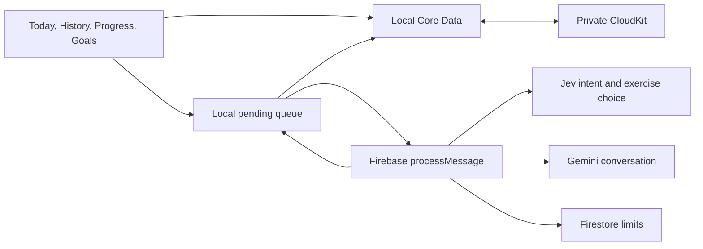

# Architecture

The iPhone owns workout records. `frontend/modules/gains-local-store` stores lifts, exercises, aliases, and goals in Core Data mirrored through `NSPersistentCloudKitContainer` to the user's private iCloud database. Recent chat and the pending queue use a separate local Core Data store. Firebase keeps anonymous identity and rate limit documents; it does not store workout history.

`frontend/services/bridge.ts` loads a snapshot, publishes it to screens, and drains pending messages in timestamp order. It creates a user message and queue item before networking. A stable request ID and local record check prevent retries from adding a second lift. The callable returns a draft; only the phone writes the final record. For a history question, the phone retrieves a few relevant lifts and sends those snippets for an answer.

The old HTTP API remains temporarily for transition. Its user routes trust a caller supplied user ID. They must not be used by the new client and must be retired after import verification. See [migration](migration.md).
